<div align="center">

# JobFit

**Evidence-grounded job matching and skill-gap analysis for early-career AI and data job seekers.**

JobFit ranks job postings for a CV and checks every requirement against the CV, quoting the exact text that proves it.<br>
No match claim without evidence.

[](https://github.com/Gidion123/Job-Fit/actions/workflows/tests.yml)
[](https://jobfit-demo.duckdns.org)


[](LICENSE)

**[Try the live demo](https://jobfit-demo.duckdns.org)** · **[Documentation](docs/README.md)** · **[Results](#results)** · **[Run it locally](#getting-started)**

Built by **Gidion Depari** · [GitHub @Gidion123](https://github.com/Gidion123) · [LinkedIn](https://www.linkedin.com/in/gidion2)

<br>

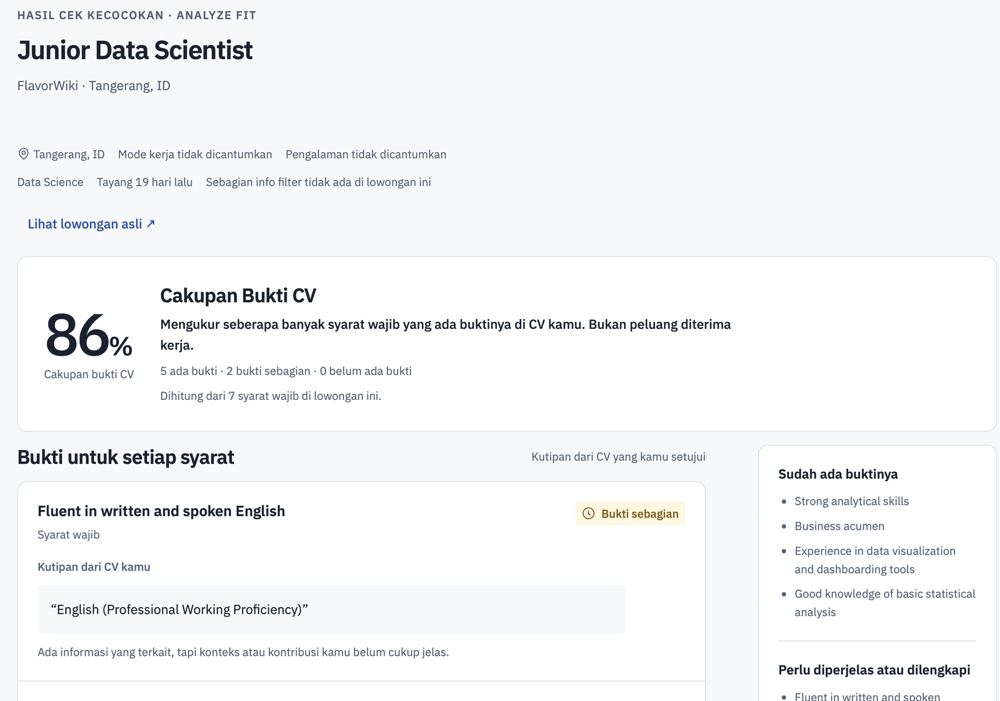

<sub>Analyze Fit on a real run: 86% evidence coverage, 5 of 7 required items matched and 2 partly matched, each backed by a quote from the CV.</sub>

</div>

> **Live demo access.** The demo runs on a VPS behind HTTP Basic Auth so that paid model calls stay within a fixed budget. Credentials are shared on request; contact the author through GitHub or LinkedIn.

## Table of contents

- [Why JobFit](#why-jobfit)
- [Features](#features)
- [Screenshots](#screenshots)
- [Results](#results)
- [How it works](#how-it-works)
- [Architecture and deployment](#architecture-and-deployment)
- [Privacy and cost controls](#privacy-and-cost-controls)
- [Tech stack](#tech-stack)
- [Getting started](#getting-started)
- [Project status](#project-status)
- [Repository structure](#repository-structure)
- [Limitations and next steps](#limitations-and-next-steps)
- [Documentation](#documentation)
- [Author and license](#author-and-license)

## Why JobFit

Job boards show many postings, but early-career candidates cannot easily tell which ones are realistic. In the job corpus collected for this project:

- **128 of 405** titles with no seniority marker still ask for 3+ years of experience, so the title is not a safe filter.
- **49 of 463** titles that mention "AI" are not AI roles at all.
- Existing "match scores" rarely explain *why* a job fits.

JobFit answers three questions for a candidate:

1. Which jobs fit my target role and experience level?
2. For each requirement in a job, is there evidence in my CV?
3. Which gaps matter most, and how can I describe my real experience more clearly?

## Features

| Feature | What it does |
| --- | --- |
| **Find Jobs** | Hybrid search (PostgreSQL full-text + dense embeddings) over the job corpus, with optional filters for role family, country, city, experience, work mode and posting date. Returns up to 30 relevant jobs without a score. |
| **Analyze Fit** | For one chosen job: labels every requirement MATCH, PARTIAL or NO_MATCH, quotes the CV word for word, verifies each quote, and computes an evidence-coverage score. |
| **Check a Job** | Paste any job description and analyze it directly. The pasted text stays in the session and is never added to the corpus. |
| **Improve My CV** | Job-specific advice that only clarifies real experience: rewrite hints for partial evidence, questions for possibly missing items (drafts are built only from the user's answers), and honest learning ideas for confirmed gaps. |
| **Privacy by design** | A local sanitizer removes name, contact details and the profile summary before any model call. The user reviews the exact text and gives consent first. Sessions can be deleted at any time. |
| **Cost safety** | Every paid call is reserved and settled in a persistent usage ledger, with daily and lifetime budgets and per-session limits. |
| **Monitoring** | Prometheus metrics and a 21-panel Grafana dashboard for system health, API, AI pipeline, LLM usage and cost. |
| **Saved demo** | A free, offline demo with precomputed results, for running JobFit without an API key. |

The interface is in Indonesian (with an English switch), because the target users are job seekers in Indonesia.

## Screenshots

| Upload and sanitized preview | Consent before any model call |
| :---: | :---: |
| 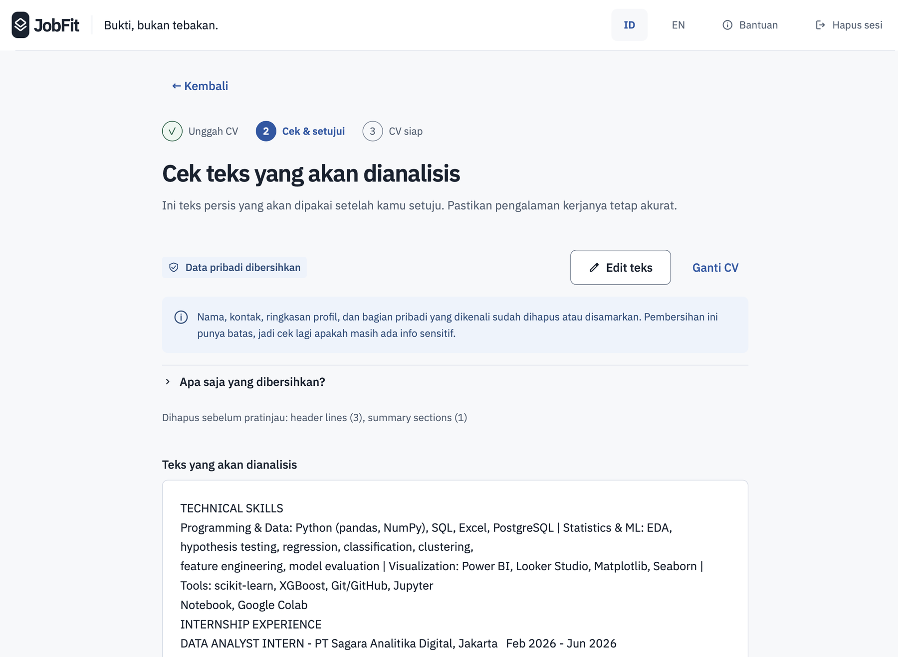 | 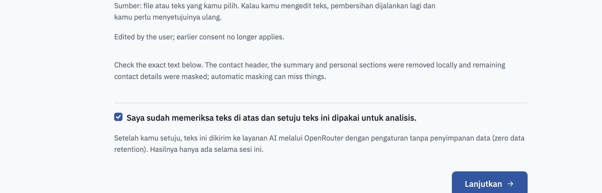 |
| **Relevant Jobs (search order, no score yet)** | **Evidence per requirement with CV quotes** |
| 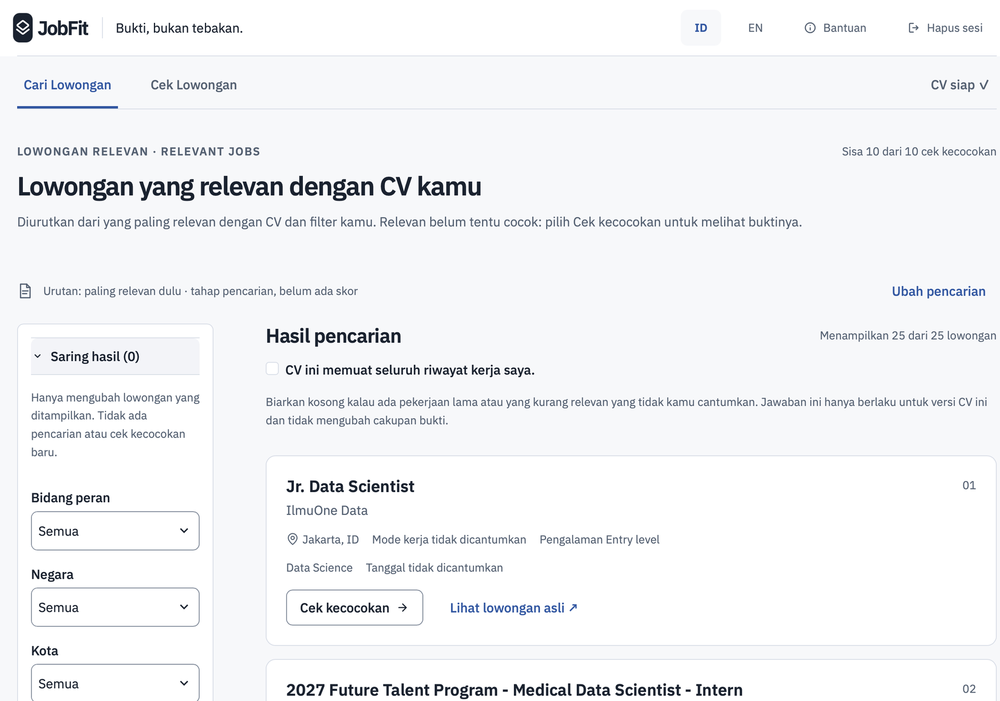 | 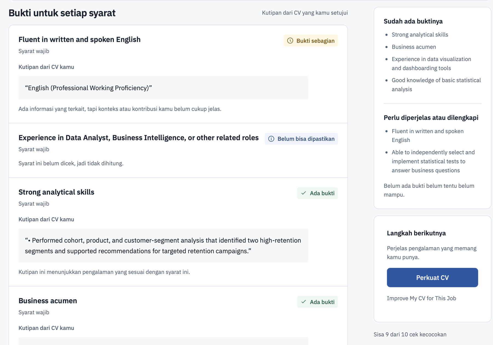 |
| **Improve My CV: draft only from the user's answers** | **Check a Job on the deployed demo** |
| 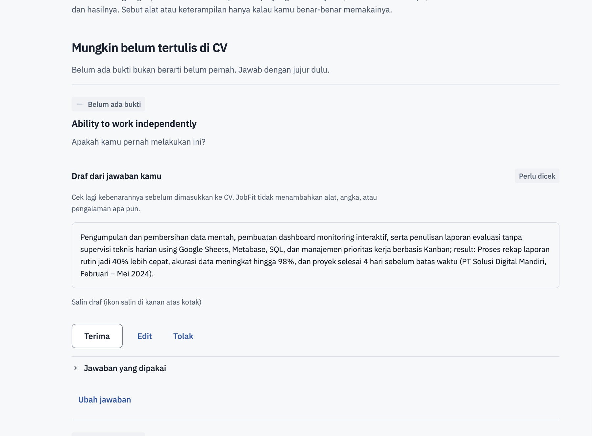 | 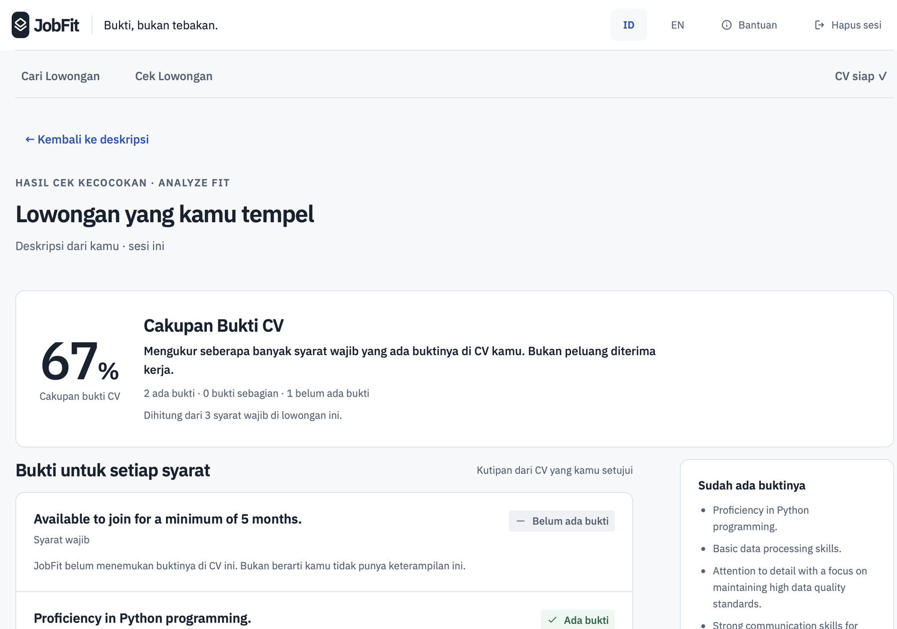 |

<details>
<summary><b>Production monitoring (Grafana)</b></summary>
<br>

| LLM attempts, latency and tokens | Budget and cost safety |
| :---: | :---: |
| 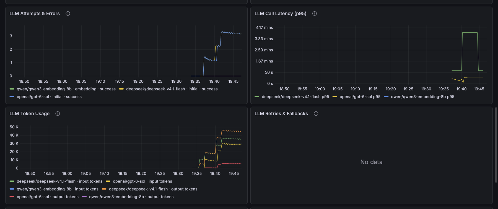 | 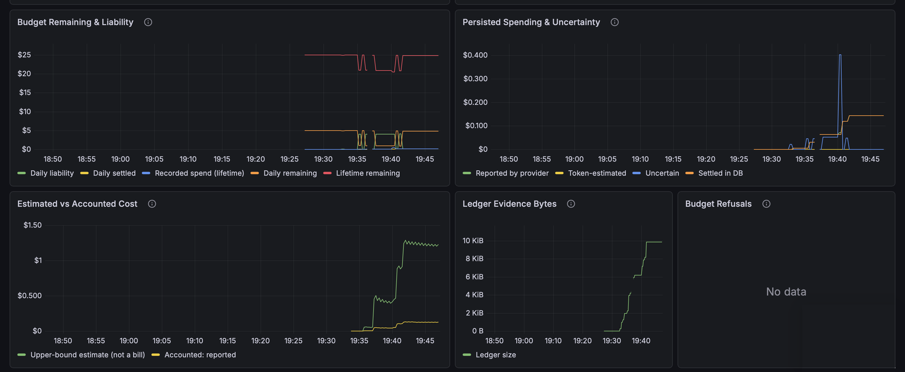 |
| **System health** | **API and AI pipeline** |
| 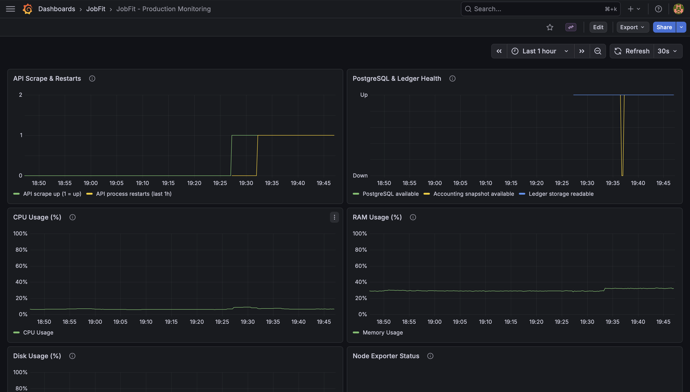 | 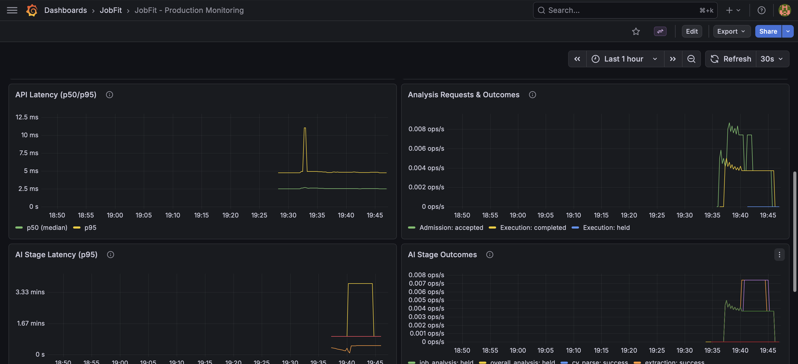 |

</details>

All 19 screenshots, with captions and capture times, are in [`reports/figures/cp3`](reports/figures/cp3/README.md).

## Results

The matching pipeline was selected on development data and **frozen before the held-out test** ([D-087](docs/decisions.md)). The headline uses three synthetic held-out CV profiles on held-out jobs and compares the plain search order with JobFit's final order.

| Metric (held-out, CV3-CV5) | Search order | JobFit final order |
| --- | ---: | ---: |
| P@5 (macro, 3/3 CVs) | 0.533 | **0.733** |
| NDCG@10 (macro, CV3 and CV4)* | 0.805 | **0.960** |
| Positive evidence items backed by an exact CV quote | n/a | **519 / 519** |

<sub>*CV5's final NDCG@10 is not reported because one job in its top 10 is unjudged, and unjudged jobs are never counted as irrelevant.</sub>

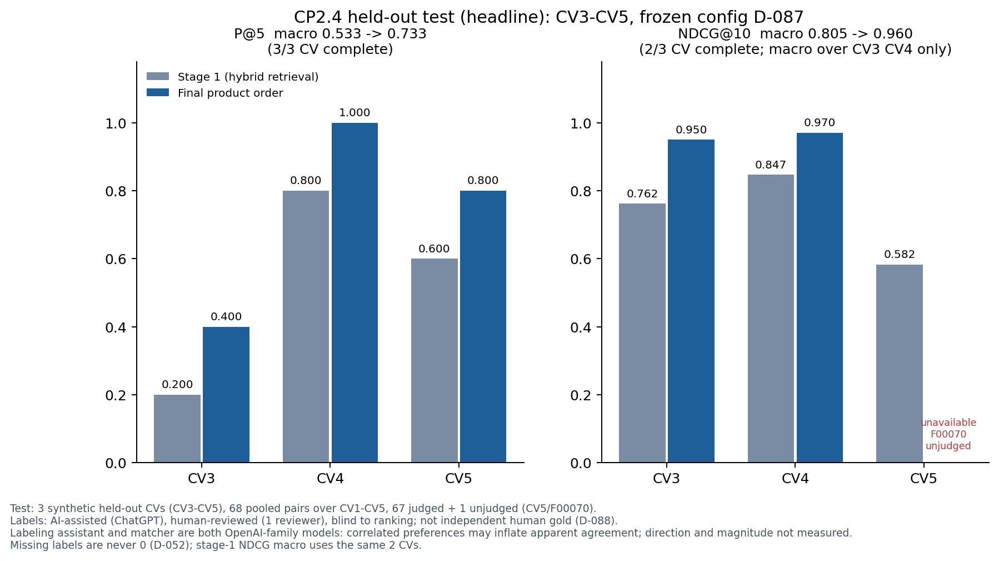

- Most of the P@5 gain comes from the deterministic seniority rule; most of the NDCG@10 gain comes from the LLM evidence order ([CP2.5](docs/checkpoint_2/CP2_05_Evaluation_Visualization.md)).
- A post-test prompt study on development data found no eligible challenger, so the baseline evidence prompt stays ([D-090](docs/decisions.md)).
- **Read with care:** three synthetic CVs, one job snapshot, one run per CV. Relevance labels were drafted with LLM assistance and reviewed by one person, blind to JobFit's ranking ([D-088](docs/decisions.md)). The result is indicative, not a general claim.

Full evaluation: [CP2.4 metrics](docs/checkpoint_2/CP2_04_Evaluation_Metrics.md) · [figures](docs/checkpoint_2/CP2_05_Evaluation_Visualization.md) · [recommendation and error analysis](docs/checkpoint_2/CP2_06_Recommendation_and_Summary.md).

## How it works

JobFit uses pretrained models through an API. It does not train a neural network.

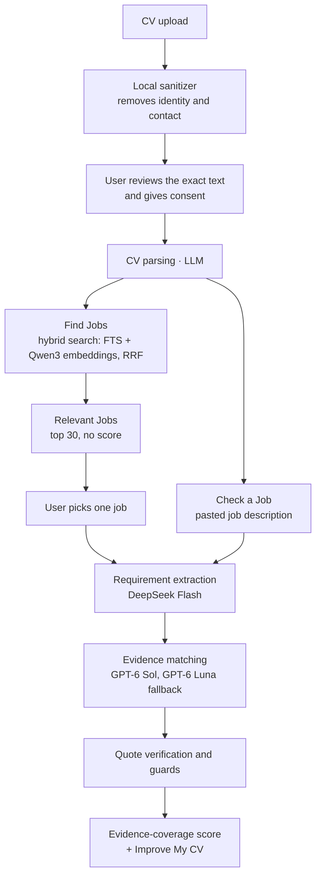

1. **Sanitize and consent.** The CV is cleaned locally (name, contact header, summary and privacy-only sections are removed, remaining contact details are masked). The user sees the exact text and consents to it before any provider call.
2. **Search.** Hybrid PostgreSQL full-text search and Qwen3-Embedding-8B vectors, fused with reciprocal rank fusion (k = 60). Search returns relevant jobs only; it does not score them.
3. **Requirements.** An LLM (DeepSeek Flash) turns the job description into requirement units, checked against the source text and cached per job.
4. **Evidence matching.** An LLM (GPT-6 Sol, with GPT-6 Luna as fallback) labels each requirement MATCH, PARTIAL or NO_MATCH and must quote the CV word for word. Every quote is verified against the CV.
5. **Score.** Evidence coverage is computed with a fixed rule, not a model:

   **score = (MATCH + 0.5 × PARTIAL) / required items × 100%**

   Example: 7 required items with 5 MATCH and 2 PARTIAL give (5 + 1) / 7 = 86%. If a required item cannot be judged reliably, the score is held instead of guessed. The score measures evidence coverage; it is not a hiring probability.

Pipeline details: [CP2.6 final architecture](docs/checkpoint_2/CP2_06_Recommendation_and_Summary.md) and the [decision log](docs/decisions.md).

## Architecture and deployment

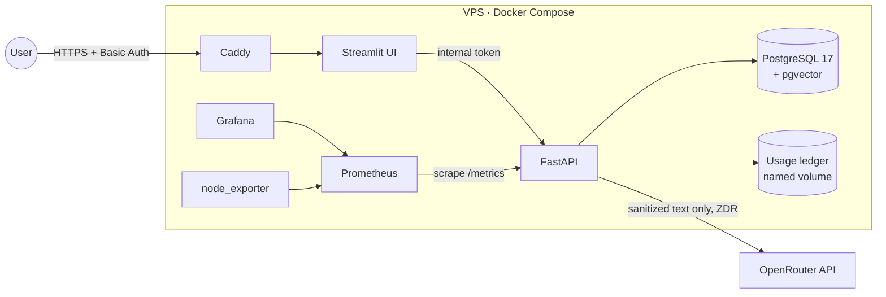

- **Streamlit** is the presentation layer only; all logic runs in **FastAPI** (sessions, consent, sanitizer, quotas, budget checks, search, analysis and scoring).
- **PostgreSQL 17 + pgvector** stores the job corpus, the full-text index and the embeddings. The schema is managed with **Alembic**.
- Models are called through **OpenRouter** with zero-data-retention routing. Only sanitized, consented text leaves the server.
- The stack runs with **Docker Compose** on a VPS (Ubuntu 24.04, 2 vCPU, 4 GB). The API, UI and database bind to `127.0.0.1`; only Caddy is public. Grafana is reached through a private SSH tunnel.
- **GitHub Actions** runs on every push: ruff, the offline test suite, a freeze check that the evaluated files are unchanged, Docker image builds, a `/health` smoke test and a ledger persistence test.

Deployment guide: [`deploy/public-live`](deploy/public-live/README.md) · monitoring: [`deploy/observability`](deploy/observability/README.md).

## Privacy and cost controls

| Control | Implementation |
| --- | --- |
| Data minimization | Local sanitizer before any model call; the edited preview is sanitized again on every change ([D-104](docs/decisions.md)). |
| Consent | Bound to a digest of the exact sanitized text; any edit requires new consent. |
| Provider routing | OpenRouter with zero data retention and data collection denied. |
| Sessions | Owner-scoped, expiring, and deletable from the UI. Feedback is stored as categories only. |
| Budgets | US$5 per day and US$25 lifetime, reserved before each paid call and settled in a persistent ledger. |
| Limits | Per session: 1 CV parse, 1 search and up to 10 job analyses. Per IP: 10 tickets per 24 hours. |
| Logs and metrics | Structured logs and bounded metric labels with no CV content. |

The full threat model is in [docs/privacy-threat-model.md](docs/privacy-threat-model.md).

## Tech stack

| Area | Tools |
| --- | --- |
| Language and data | Python 3.11, pandas, NumPy, matplotlib, Jupyter, Pydantic |
| Search and storage | PostgreSQL 17, pgvector, full-text search, Alembic |
| Models (via OpenRouter) | Qwen3-Embedding-8B (embeddings), DeepSeek Flash (requirement extraction), GPT-6 Sol and GPT-6 Luna (evidence matching) |
| Application | FastAPI, Uvicorn, Streamlit |
| Infrastructure | Docker, Docker Compose, Caddy, VPS (Ubuntu 24.04) |
| Monitoring | Prometheus, Grafana, node_exporter |
| Quality | pytest, ruff, GitHub Actions |

## Getting started

**Requirements:** Python 3.11 and Docker.

```bash
git clone https://github.com/Gidion123/Job-Fit.git
cd Job-Fit

python3.11 -m venv env-job-fit
source env-job-fit/bin/activate          # Windows: env-job-fit\Scripts\activate
pip install -r requirements.txt -r requirements-dev.txt
pip install -e .
```

### Run the free saved demo (no API key, no cost)

```bash
docker compose up -d --build             # database, API (port 8000) and UI (port 8501)
```

Open <http://127.0.0.1:8501> and choose a demo CV. The Docker images always start with live analysis switched off.

### Run the tests

```bash
python -m pytest -q
python scripts/prepare_cp23_freeze.py --verify evals/freeze/cp23_freeze_draft_v2
```

The test suite is offline and uses fake providers, so it never makes a paid call. On 11 October 2026 it ran with **1,539 passed and 238 skipped** (the skipped tests need a local test database or git-ignored raw data). The freeze check prints `"ok": true` when every evaluated file is unchanged.

### Run live analysis (uses paid API calls)

```bash
cp .env.example .env                     # add OPENROUTER_API_KEY and the budget values; never commit .env
docker compose up -d db                  # local PostgreSQL with pgvector
python scripts/load_snapshot_to_db.py    # load the 632-job snapshot
uvicorn jobfit.api.wiring:create_default_app --factory --app-dir src
streamlit run ui/streamlit_app.py        # in a second terminal
```

Every live call goes through the budget guard. Set `JOBFIT_LIVE_ENABLED=0` to keep the saved demo only. Step-by-step guides: [owner-local runbook](docs/checkpoint_3/Runbook_Owner_Local_Validation.md) and [deployment guide](deploy/public-live/README.md).

## Project status

JobFit was built as the final project of the Data Science and Machine Learning bootcamp at Dibimbing (Batch 42), in three checkpoints.

| Checkpoint | Scope | Status |
| --- | --- | --- |
| **CP1** | Data collection, cleaning, feature transformation, EDA | Done (27 Sep 2026) · [reports](docs/checkpoint_1/README.md) |
| **CP2** | Labels, retrieval and LLM comparison, tuning, frozen held-out evaluation | Done (7 Oct 2026) · [reports](docs/checkpoint_2/README.md) |
| **CP3** | FastAPI service, database and CI/CD, Streamlit app, deployment, monitoring, final presentation | Deployed and presented (11 Oct 2026) · [reports](docs/checkpoint_3/README.md) |

On 10 October 2026 the full user flow was run end to end on the deployed demo with live models: upload, sanitized preview, consent, Find Jobs, Analyze Fit, Improve My CV and Check a Job, with the production API monitored in Grafana. The final presentation with a live demo was given on 11 October 2026.

## Repository structure

```text
Job-Fit/
├── src/jobfit/        Python package: search, extraction, matching, scoring, privacy, sessions, API, live runtime
├── ui/                Streamlit app (calls the API only)
├── tests/             Unit, API, UI, privacy and pipeline tests
├── migrations/        Alembic revisions for the production schema
├── config/            Model registry, retrieval and pipeline settings, CP3 cost bounds
├── prompts/           Versioned LLM prompts
├── data/              Processed job corpus, frozen snapshot and five synthetic CVs
├── evals/             Labels, splits, freeze receipts, results and the saved demo
├── notebooks/         CP1 research, CP2 held-out evaluation, post-test optimization
├── scripts/           Collection, evaluation, freeze, deployment and end-to-end scripts
├── reports/           Figures (CP1, CP2, CP3 screenshots), validation records, usage ledger
├── deploy/            VPS overrides: controlled demo, owner-live, Prometheus and Grafana
├── docs/              Plan, decision, experiment and failure logs, one report per checkpoint stage
├── evidence/          CP1 collection evidence and provider benchmark
├── .github/workflows/ CI: lint, offline tests, freeze check, Docker builds, smoke tests
└── docker-compose.yml, Dockerfile.api, Dockerfile.ui, pyproject.toml, requirements*.txt
```

Folder-by-folder detail: [docs/repo-structure.md](docs/repo-structure.md).

## Limitations and next steps

**Limitations**

- The held-out test is small: three synthetic CVs, one job snapshot from one source (September 2026), labels reviewed by one person.
- Not yet recorded: a canary privacy sweep on the deployed host and a comparison of matching quality on original versus sanitized CVs. Until then, JobFit makes no claim that privacy is validated end to end or that sanitizing leaves matching quality unchanged.
- Job posting content belongs to the original publishers. Raw API responses are not included because they contain recruiter contact details ([data contract](docs/data-contract.md)).

**Next steps** ([details](docs/checkpoint_3/CP3_05_Final_Presentation_and_Portfolio.md))

1. Run the deployed privacy canary sweep and the original-versus-sanitized comparison.
2. Extend the LLM cost comparison with a larger sample and a per-user cost estimate.
3. Rank the whole job database by match rate, using cheap pre-filtering so the LLM only analyzes top candidates.
4. Refine the scoring formula and add stress and performance tests.
5. Make CV suggestions more specific per job description, without adding claims the CV cannot support.
6. Add per-request LLM tracing with Langfuse (the integration is in place but switched off for the demo).
7. Evaluate with real CVs, with consent, and at least two reviewers.

## Documentation

| Document | Content |
| --- | --- |
| [Documentation index](docs/Documentation_Index.md) | Where everything is |
| [Master plan](docs/master-plan.md) | Stages, dates and outcomes |
| [Decision log](docs/decisions.md) | Every design decision and why it was made |
| [Experiment log](docs/experiments.md) and [failure log](docs/failures.md) | What was tried, what failed and what changed |
| [CP1](docs/checkpoint_1/README.md) · [CP2](docs/checkpoint_2/README.md) · [CP3](docs/checkpoint_3/README.md) | Stage reports for each checkpoint |

## Author and license

**Gidion Depari** · [GitHub @Gidion123](https://github.com/Gidion123) · [LinkedIn](https://www.linkedin.com/in/gidion2)<br>
Final project, Data Science and Machine Learning Bootcamp, Dibimbing (Batch 42).

The code is released under the [MIT License](LICENSE). The license does not cover job posting content in `data/` and `evidence/`, which belongs to the original publishers, or third-party screenshots in `evidence/`. The CVs in `data/synthetic_cvs/` are fictional.
